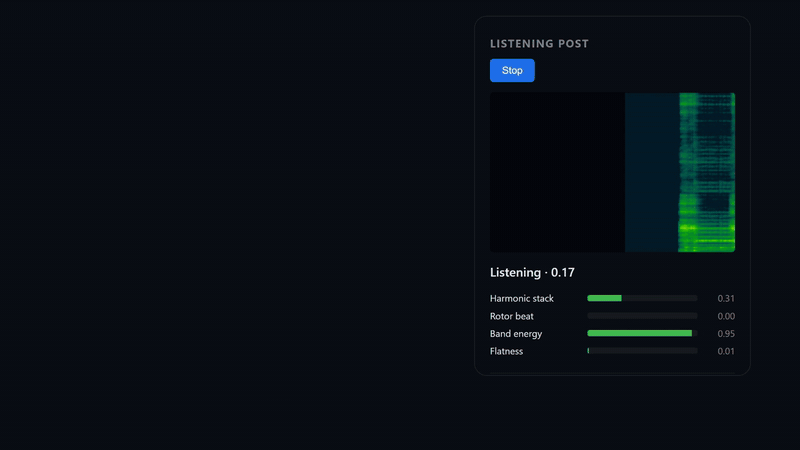
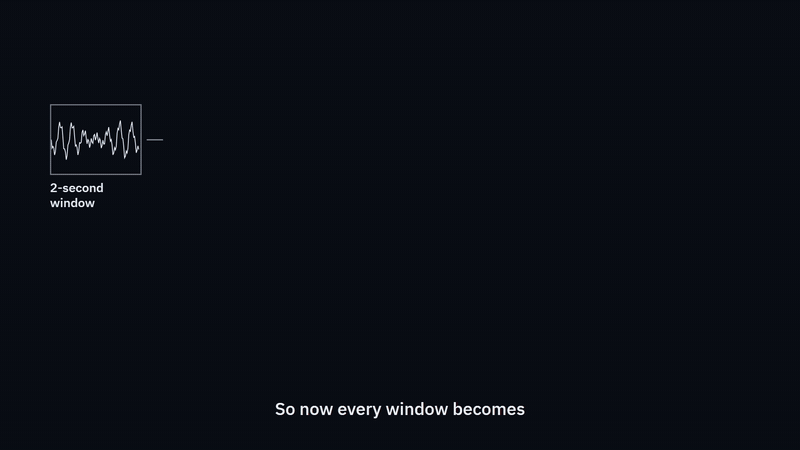
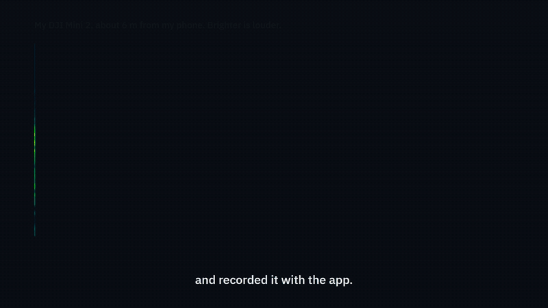
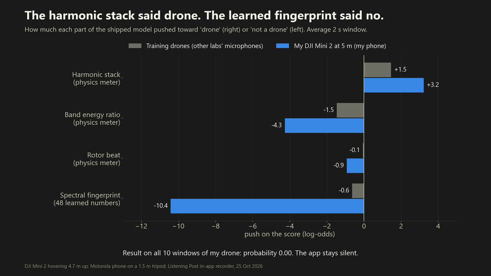

<div align="center">


# Listening Post

**Acoustic drone detection that runs on a phone instead of a ten-thousand-dollar sensor.**

[](https://endokelp.github.io/listening-post/) [](package.json) [](tests) [](https://www.congressionalappchallenge.us/)

<a href="https://endokelp.github.io/listening-post/assets/listening-post-demo.mp4">
  
</a>

<sub>The real app on held-out test audio. A DJI Tello it never trained on sets off an alert; a chainsaw does not.<br>
<a href="https://endokelp.github.io/listening-post/assets/listening-post-demo.mp4"><b>Watch the 3-minute demo film</b></a></sub>

<br>

[Try it](https://endokelp.github.io/listening-post/) · [How it works](#how-it-works) · [Results](#results-on-real-audio) · [Field test](#field-test-my-own-drone) · [Limits](#where-it-stops-working) · [Run it](#run-it-locally)

</div>

<br>

## What it does

Open the page on a phone, tap **Start listening** and allow the microphone. Once a second, the app scores the last two seconds of sound. A live spectrogram shows what the microphone hears, four meters show why the app leans one way or the other, and a log keeps every alert with its time, confidence and pitch. Nothing leaves the phone, and it can be added to the home screen like an installed app.

A listening post is a forward position whose job is to hear a threat before anyone can see it. This app does that job for small multirotor drones, with nothing but the microphone people already carry.

## Why a phone

Acoustic drone detection already works. What holds it back is the cost of each node. One expensive sensor covers one point, but small drones come from anywhere. Ukraine's Sky Fortress network ([US Army write-up](https://www.army.mil/article/292099)) showed that many cheap acoustic nodes could do the job. Listening Post asks how far a single phone can go with no added hardware, and measures the answer in the open.

**The scope is detection only.** It does not identify the model, find a direction, track, jam or intercept anything.

## How it works

<div align="center">
  
</div>

<br>

| Step | What happens |
|---|---|
| **Listen** | An AudioWorklet captures raw microphone samples. Echo cancellation, noise suppression and auto gain are switched off because each one changes the signal being measured. |
| **Describe** | Each 2-second window becomes 53 numbers: four physical meters (harmonic stack, rotor beat, band energy, flatness), a 24-band spectral fingerprint from 100 Hz to 6.5 kHz (mean and spread, 48 numbers) and one for how much the loudness moves. |
| **Score** | A logistic-regression classifier turns the 53 numbers into a probability. |
| **Decide** | An alert needs 3 of the last 5 windows above 0.7, with hysteresis and a cooldown, so one drone-like second cannot set it off. |

The fingerprint divides every 43 ms frame by its own loudness, so a quiet, distant source and a loud, close one make the same shape. A test proves the fingerprint stays the same when only the volume changes.

### The first idea, and how real audio broke it

A quadcopter's four rotors spin at slightly different speeds, so their tones beat against one another somewhere between 1 and 30 Hz. A single engine has one tone. My first detector was built on that difference, and on synthetic signals it was perfect: quadcopters read between 0.89 and 1.00, while a single engine read between 0.006 and 0.05.

Real recordings broke it. On 428 windows of real Parrot drones the rotor-beat score sat at 0.000, at the median and at the 90th percentile, because real flight controllers keep adjusting each rotor, which smears the beat. Real engines do pulse within that band. One showed lines at 22.7, 45.4 and 68.1 Hz from its combustion cycle, and chainsaws and helicopters scored higher than the drones. Rotor beat remains on screen as a meter, but it no longer decides anything alone.

## Results on real audio

Every number here comes from `npm run benchmark`, scored on recordings the classifier never trained on. Training used Parrot drones recorded indoors, outdoor flyovers of four airframes (DroneNoise, University of Salford) and ESC-50 folds 1 to 4.

**It works on microphones it has heard, and not on ones it has not.**

<div align="center">

| Drone source | Unseen recordings, lab's other recordings in training | Whole lab never heard |
|:---|:---:|:---:|
| Parrot drones, indoor phone mic | **93.9%** of windows | 6.8% |
| Four outdoor airframes, ground mics | **80.2%** of windows | 0.0% |

</div>

A fresh test that was never used for any design decision shows the same wall: one clip each of 32 airframes, recorded on a laptop microphone. The app would alert on 6 of the 32, all small toy-class drones (Tello, Syma, Hasakee) that sound like the Parrot Mambo it trained on, and on none of the DJI Mini, Mavic, Phantom or Air drones.

On held-out confusers and background sound, 4.8% of 2-second windows cross the alert threshold before the vote. Birds dropped from 94% with the first trained model to 0%. The weak spots are wind (37.5%) and a vacuum cleaner (22%).

The lesson for design is that an acoustic detector has to hear the microphone and site it guards. A phone is cheap enough to calibrate on site; a ten-thousand-dollar sensor is not. Until it has trained on recordings made through that phone, the app reads *not yet calibrated to this microphone*, and its built-in recorder saves exactly the samples the detector scores, so those recordings are easy to make.

## Field test: my own drone

<div align="center">
  
</div>

<br>

I flew a DJI Mini 2 at a 4.7 m hover in my yard and recorded it through the app on a phone the model had never heard, around 6 m and 10.5 m away.

- **The model said no on all 10 windows.** Every probability was below 0.002, which matches the cross-lab table above.
- **The rotors were plainly there at 6 m.** Two families of tones sat near 287 and 322 Hz, each with its own harmonics, the strongest 23 dB above the surrounding spectrum. At 10.5 m there was no steady rotor line.
- **The physics meter got it right and the learned part did not.** The harmonic stack rated my drone more drone-like than the training drones (+3.2 against +1.5). The spectral fingerprint, learned from other labs' drones, microphones and sites, pushed it down to -10.4.

<div align="center">
  
</div>

## Where it stops working

1. **A new microphone or site.** Detection falls below 10% on a lab it has never heard.
2. **Wind** is the worst natural false alarm, at 37.5% of windows.
3. **Rotor beat alone cannot separate a drone from a real engine.** Engines pulse in the same band.
4. **One microphone gives presence only**, with no direction or range.
5. **Short range for small drones.** A DJI Mini 2's rotor lines were clear at about 6 m and gone at about 10.5 m in a suburban yard.

## Run it locally

```bash
npm test                                  # Node 22+, no install step
npm run serve                             # then open http://localhost:8000
pip install -r train/requirements.txt     # training and benchmark pipeline
npm run benchmark                         # fetch public data, train, write docs/BENCHMARK.md
```

The microphone needs `localhost` or HTTPS.

## Built with

- **JavaScript, Web Audio API and AudioWorklet.** No frameworks and no runtime dependencies. The FFT, windowing and mel filterbank are written in this repo.
- **Python** (numpy, scipy, scikit-learn) for data, training and the benchmark. `train/features.py` mirrors the browser feature code, and a golden-vector test fails the build if the two drift apart by as little as 1%.
- **Node's built-in test runner** for the test suite.

```
src/features/   FFT, window, mel filterbank, harmonic stack, rotor beat, feature vector
src/audio/      microphone capture (AudioWorklet), ring buffer, WAV export
src/classify/   classifier and its trained weights
src/detect/     3-of-5 vote, hysteresis, cooldown
src/ui/         spectrogram, meters, detection log, field recorder
train/          Python feature mirror, datasets, training, benchmark, field figures
tests/          node:test suite, including the JS and Python parity test
```

## Data

All audio is downloaded from its original source by `train/datasets.py`. None of it is stored in this repository.

| Dataset | Used for | Licence |
|---|---|---|
| [Al-Emadi DroneAudioDataset](https://github.com/saraalemadi/DroneAudioDataset) (Parrot Bebop and Mambo, indoor) | training | none stated |
| [DroneNoise Database](https://doi.org/10.17866/rd.salford.22133411.v3), University of Salford (outdoor) | training | CC BY 4.0 |
| [ESC-50](https://github.com/karolpiczak/ESC-50) (engines, chainsaws, wind, birds and more) | folds 1 to 4 train, fold 5 test | CC BY-NC 3.0 |
| [Svanström drone-detection dataset](https://github.com/DroneDetectionThesis/Drone-detection-dataset) | development test | CC0 |
| [32-airframe acoustic dataset](https://github.com/mackenzie-jane/drone-visualization) (arXiv:2509.04715) | fresh test | CC BY 4.0 |

<br>

<div align="center">
<sub>Built by Venkata Anirudh Devireddy for the 2026 Congressional App Challenge.</sub>
</div>
